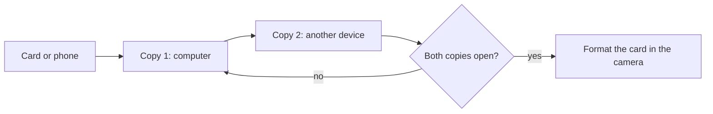

# Ingest and Backup Workflow

> [!summary] In one line
> Ingest is copying photos off the card into a place and a name you can find again.
> Backup is a second copy on a different device. Do both, and check them, before you
> format the card.

## What it is

A memory card is for carrying photos, not for keeping them. **Ingest** moves files from
the camera into your photo library, with a fixed folder structure and consistent names.
**Backup** is a second copy of that library on a separate device, so one failure can't
take your photos with it.

One rule holds it together: **until the second copy exists and opens, the card is one
of your two copies.** Don't format it before then.



## How it works

### Every step removes one risk

| Step | The risk it removes |
|---|---|
| Copy to the computer | The card failing, getting lost, or being formatted by mistake |
| Second copy on another device | The computer's drive failing |
| Check that both copies open | A copy that finished but is incomplete or damaged |
| Format the card in the camera | Old files mixed with new ones, and card errors |

Copying can fail without warning: a cable slips, a drive fills up, a file is cut short.
A copy you've never opened is a hope, not a backup.

### Folder and file names

One folder per shoot, inside one folder per year:

```text
Photos/
  2026/
    2026-10-26-aperture-ladder/
    2026-10-28-dry-run/
```

- **Year, month, day first,** because names in that order sort into date order.
- **Then a short slug:** a few words, lower case, hyphens, no spaces. Give the shoot's
  log in this vault the same name (`2026-10-26-aperture-ladder.md`), so notes and
  photos find each other. → [[Shoot-Log]]
- **Rename files as you copy them,** with the date in front of the camera's own name:
  `IMG_0421.DNG` becomes `2026-10-26-IMG_0421.DNG`. Cameras reuse names (most count
  from 0001 to 9999, then start again), and two devices can produce the same one. The
  date makes each name unique, and the camera's number still pairs each RAW with its
  JPEG. Most raw developers can rename like this during import.

### Checking the copies

Compare the number of files and the total size on the card and on each copy. Then open
a few files from each copy at 100%, raw files included: the first, the last and some in
between. A damaged file opens grey, half-drawn, or not at all. Some copy tools check
for you by comparing **checksums** (a fingerprint calculated from a file's contents).

### Format in the camera, not the computer

When both copies check out, format the card in the camera that will use it. The camera
sets up the file system and folders exactly the way it expects them. A computer may
choose a different format, which can cause errors later.

### 3-2-1, the short version

Keep **3** copies of every photo you care about, on **2** different kinds of storage
(for example a computer drive and an external drive, or a drive and a cloud service),
with **1** copy at another address. Module 0's exit test asks for the first step: two
copies on two devices. The full system comes in Module 4. → [[Archive-Strategy]]

### Photos never go in this vault's git repo

The vault's git repository holds notes only. Raw files, PSDs and TIFFs are blocked by
`.gitignore` on purpose, and `attachments/` takes only small web-sized JPEG or PNG
references (long edge up to 2000 px, under about 500 KB). Git keeps every version of
every file forever, so raw files would soon make the repo too big to clone. Git is your
notebook's history, not a photo backup.

## How to use it

After every shoot:

1. **Copy** into `Photos/YYYY/YYYY-MM-DD-slug/`, renaming as you go.
2. **Back up** that folder to a second device, then **check** both copies.
3. **Format** the card in its camera. Until then, keep it apart from your empty cards,
   for example upside down in its case.
4. **Cull and edit** only after that, so a tired cull can't cost you a keeper.
   → [[Culling-Discipline]]
5. **Write the shoot log** under the same name as the folder.

Once the pattern is set up, this takes a few minutes plus the copying time.

## On your kit

- **Lumix L10, Pocket 3 and Action 5 Pro:** take the card out and read it with a card
  reader or the computer's card slot. It's the fastest route, and the same for every
  camera. A USB cable to the camera also works on most cameras; check the manual. Keep
  the L10's RAW and JPEG/HEIF pairs together. The Action 5 Pro also has 47 GB of
  built-in storage: anything saved there isn't on the card, so copy it over USB too.
- **iPhone 15 Pro Max:** there's no card. Connect it with a USB-C cable, unlock it, and
  allow access when the phone asks. On a Windows PC, import with the Photos app, or copy
  from the phone's DCIM folder in File Explorer.
  - The phone can convert HEIF to JPEG during the transfer. To get the originals, look
    for the transfer option in the phone's Photos settings and choose to keep them.
  - If HEIF files won't open, install Microsoft's free HEIF Image Extensions from the
    Microsoft Store. iPhone HEIF photos are compressed with HEVC, so Windows may also
    need Microsoft's HEVC Video Extensions, which cost a little.
  - **iCloud Photos is sync, not backup.** Delete a photo on the phone and it goes from
    iCloud too. With storage optimisation on, the full-size originals may exist only in
    iCloud.
- **All four:** 48 MP ProRAW files and 4K video fill drives quickly. Check the free
  space on both backup devices before a big shoot.

## Common mistakes

- **Formatting the card before the second copy is checked.** Until then, the card is
  one of your two copies.
- **Moving instead of copying.** A move deletes the original, so you still have only
  one copy.
- **Two copies on one drive.** A second folder on the same drive dies with that drive.
- **Treating sync as backup.** iCloud and other sync services copy your deletions and
  damaged files too.

## Try it

This is **A0.2**, the timed dry run. Allow about 30 minutes.

1. Shoot 20 throwaway frames, with at least one from each of your four devices.
2. Start a timer. Ingest everything into one dated folder with the rename pattern, back
   it up to your second device, and check both copies.
3. Cull to your best frame and export it as a JPEG. → [[Export-Settings]]
4. Format the camera cards and stop the timer.
5. Write the time and the most annoying step in a shoot log. Fix that step, then run
   the whole thing again. The second run should be shorter.

## Check yourself

> [!question]- Why make the second copy before formatting the card, not after?
> Until the second copy exists, the card is one of your two copies. Format it first and
> you're down to one copy on one drive, which a single failure can wipe out.

> [!question]- Why isn't a second folder on the same drive a backup?
> Both copies depend on the same device. If the drive fails, is stolen or gets damaged,
> both copies go together. A backup has to live on a separate device.

> [!question]- Why doesn't iCloud Photos count as a backup?
> It keeps the phone and the cloud identical. Delete or damage a photo on one, and the
> change copies to the other. A backup keeps its copy even when the original is gone.

> [!question]- Why do raw files never go into the vault's git repo?
> Git keeps every version of every file forever. Large files like raws would make the
> repository too big to clone, and git isn't a photo backup anyway.

## Related
[[RAW-vs-JPEG]] · [[Archive-Strategy]] · [[Culling-Discipline]] · [[Export-Settings]] ·
[[Shoot-Log]] · [[Camera-Care]] · [[Fundamentals-Index]]
